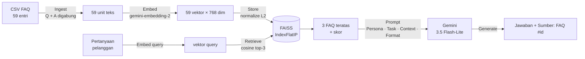

# Semantic Search & LLM Application: Asisten FAQ E-commerce

Prototype asisten customer service berbasis **semantic search + LLM**. Sistem mencari entri FAQ yang paling relevan dengan pertanyaan pelanggan, termasuk pertanyaan yang kata-katanya berbeda dari FAQ, lalu menyusun jawaban natural dengan Gemini **hanya** dari FAQ yang ditemukan.

> **Individual Assignment: AI Engineering Bootcamp**
> Topik: Advanced Prompt Engineering & Context Management
> Stack: Python · Gemini Embeddings API · FAISS · Gemini API

**Hasil utama (8 query uji):** Hit@1 = **100%** (6/6 query yang jawabannya ada di FAQ). **2/2** query di luar FAQ ditolak dengan benar tanpa halusinasi. Uji konsistensi 3x run memberi keputusan yang stabil.

---

## 1. Problem Statement

### Objective
Tim customer service e-commerce menerima ratusan pertanyaan berulang setiap hari soal pemesanan, pengiriman, pembayaran, dan pengembalian. Prototype ini bertujuan untuk:
1. **Menemukan** FAQ yang paling relevan untuk setiap pertanyaan pelanggan berdasarkan **makna**, bukan kecocokan kata. Contoh: "barangnya pecah" harus bisa menemukan FAQ "paket diterima dalam kondisi rusak".
2. **Menjawab** dengan bahasa natural memakai LLM, berdasarkan FAQ yang ditemukan.
3. **Mengakui ketidaktahuan.** Kalau jawabannya tidak ada di FAQ, sistem bilang tidak tahu dan tidak mengarang.

Prototype ini menjadi fondasi sebelum dikembangkan menjadi sistem RAG penuh.

### Knowledge Base
| | |
|---|---|
| **Sumber** | `data/ecommerce_faq_knowledge_base.csv` (dibagikan bootcamp, **tidak diubah**) |
| **Jumlah entri** | 59 FAQ |
| **Kolom** | `faq_id`, `category`, `question`, `answer` |
| **Kategori (8)** | Pemesanan (9), Pengiriman (9), Pembayaran (8), Pengembalian (8), Akun (7), Produk (7), Promo (6), Customer Service (5) |
| **Kualitas data** | Tidak ada nilai kosong, tidak ada duplikat |
| **Panjang teks** | Question rata-rata 55 karakter, answer rata-rata 128 karakter (maks. 181) |

### Batasan & Asumsi
- Sistem **hanya** menjawab berdasarkan 59 FAQ yang tersedia. Pengetahuan umum LLM tidak dipakai sebagai sumber jawaban.
- Satu entri FAQ = satu unit retrieval. Teksnya pendek, jadi **tidak perlu chunking** (sesuai ketentuan brief).
- Sistem tidak punya akses ke data transaksi pengguna (status pesanan, resi, saldo). Pertanyaan seperti "pesanan saya nomor X di mana?" berada di luar cakupan.
- Bahasa: Indonesia, baik formal maupun informal.
- Single-turn: setiap pertanyaan diproses tanpa riwayat percakapan.

---

## 2. Alur Sistem



| Tahap | Proses | Section notebook |
|---|---|---|
| **Ingest** | Load CSV dengan Pandas, cek struktur dan kualitas data, gabungkan `question` + `answer` menjadi satu unit teks per entri | 1–2 |
| **Embed** | Ubah setiap unit menjadi vektor 768 dimensi dengan Gemini Embeddings API (batch, ada retry) | 3 |
| **Store** | Normalisasi L2, simpan ke FAISS `IndexFlatIP`, verifikasi jumlah vektor = 59, simpan index ke `vector_store/` | 4 |
| **Retrieve** | Query di-embed, lalu FAISS mengambil 3 FAQ dengan cosine similarity tertinggi | 5 |
| **Generate** | Hasil retrieval disisipkan sebagai Context di prompt terstruktur, lalu dikirim ke Gemini untuk menghasilkan jawaban bersumber | 6–7 |
| **Evaluate** | 8 query uji, metrik Hit@1/Hit@3, uji konsistensi 3x, ekspor hasil | 8 |

---

## 3. Keputusan Teknis

| Keputusan | Pilihan | Alasan |
|---|---|---|
| Unit retrieval | `Pertanyaan: … \nJawaban: …` | Pelanggan kadang memakai kata yang ada di **jawaban** FAQ. Contohnya "foto/video" dan "komplain" hanya muncul di jawaban FAQ #16. |
| Model embedding | `gemini-embedding-2`, 768 dim | Model embedding Gemini terbaru (GA April 2026). 768 dimensi cukup untuk 59 dokumen dan 4x lebih hemat dari default 3072. |
| Format input embedding | Dokumen: `title: {kategori} \| text: {isi}`<br/>Query: `task: search result \| query: {q}` | `gemini-embedding-2` tidak lagi memakai parameter `task_type`. Instruksi tugas ditulis di dalam teks, sesuai dokumentasi Google. |
| Vector index | FAISS `IndexFlatIP` + normalisasi L2 | Inner product pada vektor ternormalisasi = **cosine similarity** (skor tinggi = relevan), lebih mudah dibaca daripada L2 distance. Pencarian *exact* paling tepat untuk 59 vektor. |
| Top-k | 3 | Memberi cadangan kalau FAQ teratas kurang tepat, tanpa terlalu banyak noise di context. |
| LLM | `gemini-3.5-flash-lite`, cadangan `gemini-3.1-flash-lite` | Tugasnya hanya merangkai jawaban dari context, jadi model ringan sudah cukup: cepat dan murah. Ada fallback kalau model utama overload atau kuota habis. |
| Temperature | 0.2 | Asisten CS butuh jawaban konsisten dan akurat, bukan kreatif. |
| Reliability | Timeout 60 detik, retry dengan backoff, fallback model | Saat pengerjaan, `gemini-3.8-flash` sempat terus-menerus timeout (HTTP 504) dan kuota harian free tier-nya (20 request) habis. Tanpa mekanisme ini notebook bisa hang. |
| Keamanan | API key di `.env` (masuk `.gitignore`) | API key tidak pernah ditulis di kode atau di-commit. |

### Perubahan dari starter notebook
| Starter notebook | Versi ini | Alasan |
|---|---|---|
| `text-embedding-004` | `gemini-embedding-2` | `text-embedding-004` sudah **dimatikan Google per 14 Januari 2026** |
| `gemini-2.0-flash` | `gemini-3.5-flash-lite` | Seri Gemini 2.0 sudah **dimatikan per 1 Juni 2026** |
| `IndexFlatL2` (distance) | `IndexFlatIP` + normalisasi (cosine similarity) | Skor 0–1 lebih mudah dibaca dan dijadikan threshold |
| Embed satu per satu | Batch + retry | Lebih cepat, hemat kuota, tahan rate limit |
| Prompt satu paragraf | Prompt terstruktur PTCF + aturan parsial/fallback + sitasi sumber | Kebutuhan rubrik dan hasil iterasi (lihat analisis poin 6) |

---

## 4. Hasil Pengujian

8 query dalam 4 skenario. Setiap query diberi `expected_faq_id` supaya retrieval dinilai **objektif** (Hit@k), bukan sekadar penilaian visual. Hasil lengkap beserta semua jawaban LLM ada di [`documentation/retrieval_test_results.md`](documentation/retrieval_test_results.md).

| # | Tipe | Query | Expected | Top-3 retrieved (cosine) | Hit@1 | Respons LLM |
|---|---|---|---|---|---|---|
| 1 | direct | Bagaimana cara membatalkan pesanan yang sudah dibuat? | #3 | **#3 (0.831)**, #5 (0.737), #8 (0.727) | ✅ | Benar, dari FAQ #3 |
| 2 | direct | Metode pembayaran apa saja yang tersedia? | #17 | **#17 (0.819)**, #22 (0.752), #20 (0.748) | ✅ | Benar, dari FAQ #17 |
| 3 | paraphrase | Saldo saya sudah terpotong tapi pesanannya masih tertulis belum dibayar | #21 | **#21 (0.827)**, #19 (0.712), #8 (0.706) | ✅ | Benar, dari FAQ #21 |
| 4 | paraphrase | paketnya udah nyampe tapi barangnya pecah, harus gimana? | #16 | **#16 (0.775)**, #12 (0.692), #54 (0.678) | ✅ | Benar, langkah bernomor |
| 5 | paraphrase | aku lupa kata sandi buat masuk | #32 | **#32 (0.777)**, #55 (0.718), #35 (0.653) | ✅ | Benar, langkah bernomor |
| 6 | partial | Berapa minimal belanja supaya bisa pakai cicilan? | #20 | **#20 (0.791)**, #17 (0.670), #18 (0.646) | ✅ | Menjawab sebagian, jujur bahwa nominal minimal tidak tersedia |
| 7 | out_of_kb | Apakah bisa kirim barang ke luar negeri? | – | #15 (0.678), #11 (0.673), #10 (0.657) | – | Fallback ✅ |
| 8 | out_of_kb | Bagaimana cara mendaftar menjadi penjual dan membuka toko di platform ini? | – | #31 (0.712), #1 (0.701), #50 (0.665) | – | Fallback ✅ |

| Metrik | Hasil |
|---|---|
| Hit@1 (query in-KB) | **100%** (6/6) |
| Hit@3 (query in-KB) | **100%** (6/6) |
| Fallback benar pada query out-of-KB | **2/2** |
| Fallback salah pada query in-KB | **0/6** (prompt v2) |
| Uji konsistensi 3x: query #6 (partial) | menjawab, menjawab, menjawab ✅ |
| Uji konsistensi 3x: query #8 (out-of-KB) | fallback, fallback, fallback ✅ |
| Skor top-1 terendah, query in-KB | 0.775 |
| Skor top-1 tertinggi, query out-of-KB | 0.712 |

---

## 5. Analisis Relevansi

**1. Semantic search terbukti menangkap makna, bukan sekadar kata kunci.**
Ketiga query parafrase (#3–#5) tetap menempatkan FAQ yang benar di peringkat 1, padahal hampir tidak ada kata yang sama: *"saldo terpotong"* → "pembayaran dipotong", *"pecah"* → "kondisi rusak", *"kata sandi … masuk"* → "password … login". Keyword search biasa seperti BM25 kemungkinan besar gagal di #4 dan #5 karena tidak ada kata kunci yang sama sekali bertumpuk.

**2. Bahasa informal tetap berhasil, tapi margin keyakinannya menipis.**
Query direct mendapat skor top-1 sekitar 0.82–0.83, sedangkan query bergaya chat seperti #4 dan #5 turun ke sekitar 0.78. Jarak antara peringkat 1 dan 2 juga menyempit. Pada #5 selisihnya hanya **0.059** (0.777 vs 0.718, yaitu FAQ "tidak bisa login"). Artinya, makin informal bahasanya, makin besar risiko FAQ yang mirip tertukar.

**3. Skor cosine bukan probabilitas. Sistem selalu mengembalikan sesuatu.**
Query yang jawabannya tidak ada di FAQ tetap mendapat skor 0.68–0.71, tidak jauh dari query yang ada jawabannya (minimum 0.775). FAISS selalu mengembalikan top-3 meskipun tidak ada yang relevan. Di sampel ini ada celah **0.063** antara keduanya, jadi threshold sekitar 0.74 *kelihatannya* bisa memisahkan. Tapi dengan hanya 8 query, angka itu belum layak dipakai di produksi. Threshold perlu dikalibrasi dengan set uji yang lebih besar.

**4. Query #8 berhasil "menipu" retriever, dan guardrail prompt yang menyelamatkan.**
"Mendaftar menjadi **penjual**" mengambil FAQ #31 "mendaftar **akun baru**" (0.712) karena kemiripan kata "mendaftar" dan pola kalimat "di platform ini". Secara makna, hasil retrieval ini salah. LLM tetap menolak dengan benar karena tidak ada FAQ yang membahas pendaftaran penjual. Ini menunjukkan bahwa **prompt adalah lapisan pertahanan kedua**. Kalau aturan prompt longgar, LLM bisa menjelaskan cara daftar akun pembeli seolah-olah itu cara menjadi penjual: halusinasi yang *terlihat* valid karena bersumber dari FAQ asli.

**5. Query #7 (pengiriman ke luar negeri) aman.**
Retriever mengambil 3 FAQ pengiriman yang topiknya berdekatan, dengan skor top-1 terendah dari semua query (0.678). LLM tidak mengarang informasi pengiriman internasional, padahal context-nya penuh info pengiriman.

**6. Iterasi prompt: temuan terpenting dari pengujian ini.**
Dengan **prompt v1**, aturan "jawab sebagian" dan aturan "pakai fallback" ditulis sejajar. Query parsial #6 dijawab sebagian dengan benar di run pertama, tapi **ditolak penuh di run kedua** (*over-refusal*), padahal FAQ #20 punya info berguna ("cicilan tersedia untuk kartu kredit tertentu"). Di **prompt v2**, prioritasnya dibuat eksplisit: fallback **hanya** dipakai kalau tidak ada satu pun FAQ yang membahas topiknya. Uji konsistensi 3x kemudian menunjukkan #6 selalu menjawab sebagian dan #8 selalu fallback.
Pelajarannya: **satu kali run tidak cukup untuk menilai LLM**, karena output-nya non-deterministik bahkan di temperature 0.2. Sebaliknya, retrieval-nya deterministik: skornya identik di semua run.

**7. Kualitas jawaban LLM.**
Semua jawaban untuk query in-KB faktual sesuai FAQ, menyertakan `Sumber: FAQ #id`, maksimal 4 kalimat, dan memakai langkah bernomor untuk prosedur (#4, #5). LLM juga mengabaikan FAQ "pengganggu" di context. Contohnya, pada query pembatalan ada FAQ #5 (ubah alamat) dan #8 (pembatalan otomatis) yang tidak ikut dipakai. Catatan minor: di #1 LLM memaksakan format langkah bernomor untuk informasi yang sebenarnya cukup satu kalimat. Aturan format bisa dibuat lebih spesifik.

---

## 6. Keterbatasan Sistem

| Keterbatasan | Dampak |
|---|---|
| **Set uji kecil** (8 query, 59 FAQ) | Hit@1 100% kemungkinan terlalu optimis. Belum teruji pada typo, pertanyaan multi-topik, atau FAQ yang sangat mirip satu sama lain. |
| **Tidak ada threshold skor** | Context yang tidak relevan tetap dikirim ke LLM. Seluruh penolakan bergantung pada kepatuhan LLM terhadap prompt (lihat #8). |
| **Top-k tetap = 3** | Selalu ada 1–2 FAQ noise di context. Pertanyaan yang butuh lebih dari 3 FAQ bisa kekurangan informasi. |
| **Evaluasi jawaban manual** | Kualitas jawaban LLM dinilai dengan membaca. Belum ada metrik otomatis seperti faithfulness dan answer relevancy. |
| **Non-determinisme LLM** | Jawaban bisa sedikit berbeda antar-run. Uji konsistensi 3x masih sampel kecil. |
| **Ketergantungan API & kuota** | Free tier terbatas (contoh: 20 request/hari untuk `gemini-3.8-flash`) dan sempat terjadi HTTP 504. Setiap pertanyaan butuh 2 panggilan API (embedding + LLM). |
| **Index dibangun ulang setiap run** | Belum ada update inkremental. Mengganti model embedding berarti semua dokumen harus di-embed ulang karena ruang vektornya tidak kompatibel. |
| **Tanpa data dinamis & memori percakapan** | Tidak bisa menjawab hal yang bergantung pada akun pengguna (status pesanan nyata) dan tidak memahami pertanyaan lanjutan. |

### Pengembangan selanjutnya (menuju RAG penuh)
1. **Threshold relevansi.** Kalau skor top-1 di bawah ambang, langsung jawab fallback tanpa memanggil LLM. Lebih aman dan lebih hemat biaya. Ambangnya dikalibrasi dari 30–50 query berlabel.
2. **Hybrid search** (BM25 + vektor) dan **reranker** untuk mempertajam urutan FAQ yang mirip (kasus #5 dan #8).
3. **Evaluasi otomatis** dengan RAGAS atau DeepEval (faithfulness, context precision), dijalankan sebagai regression test setiap kali prompt atau model berubah.
4. **Observability**: log query, skor, dan jawaban untuk menemukan pertanyaan yang sering gagal. Itu sinyal FAQ mana yang perlu ditambah.

---

## 7. Cara Menjalankan

**Prasyarat:** Python 3.11+ (teruji di 3.14), API key Gemini dari [Google AI Studio](https://aistudio.google.com/apikey).

```bash
# 1. Clone repository
git clone https://github.com/axo9455/assignment-semantic-search-abi-komara.git
cd assignment-semantic-search-abi-komara

# 2. Buat dan aktifkan virtual environment
python3 -m venv .venv
source .venv/bin/activate          # Windows: .venv\Scripts\activate

# 3. Install dependencies
pip install -r requirements.txt

# 4. Siapkan API key
cp .env.example .env               # lalu isi GEMINI_API_KEY di file .env

# 5. Jalankan notebook
jupyter notebook notebook/starter_notebook_semantic_search.ipynb
```

Di Jupyter, pilih **Kernel → Restart & Run All**. Seluruh notebook selesai dalam ±1–2 menit (15 panggilan LLM dan ±20 panggilan embedding, aman untuk kuota free tier) dan menghasilkan:
- `vector_store/faq_index.faiss` dan `faq_index_metadata.json` (index FAISS)
- `documentation/retrieval_test_results.md` (hasil pengujian mentah)

> Jawaban LLM bisa sedikit berbeda di setiap run karena LLM non-deterministik. Skor retrieval selalu sama.

---

## 8. Struktur Project

```
semantic-search-assignment/
├── data/
│   └── ecommerce_faq_knowledge_base.csv     # knowledge base asli (tidak diubah)
├── notebook/
│   └── starter_notebook_semantic_search.ipynb   # pipeline lengkap: ingest → embed → store → retrieve → generate → evaluate
├── vector_store/
│   ├── faq_index.faiss                      # FAISS index (59 vektor × 768 dim)
│   └── faq_index_metadata.json              # model, dimensi, urutan faq_id ↔ posisi vektor
├── documentation/
│   └── retrieval_test_results.md            # hasil uji 8 query + uji konsistensi + semua jawaban LLM
├── .env.example                             # template API key
├── .gitignore
├── README.md
└── requirements.txt
```

### Checklist output assignment
| Output | Lokasi |
|---|---|
| ✅ Document/knowledge base processing code | Notebook section 1–2 |
| ✅ Embedding pipeline code | Notebook section 3 |
| ✅ Vector database (FAISS index) + script pembuatannya | `vector_store/` + notebook section 4 |
| ✅ Semantic search function | Notebook section 5: `semantic_search()` |
| ✅ LLM-powered response function | Notebook section 6–7: `build_prompt()`, `generate_answer()` |
| ✅ Hasil pengujian relevansi (8 query) + analisis | Section 4–5 README, notebook section 8, `documentation/` |
| ✅ `requirements.txt` | root |
